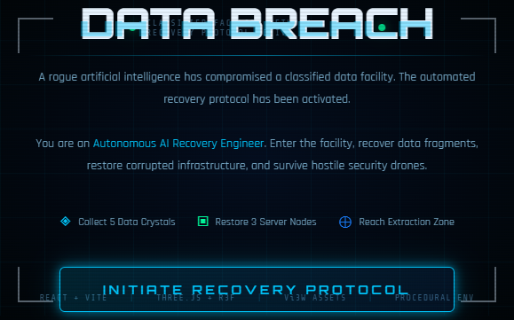
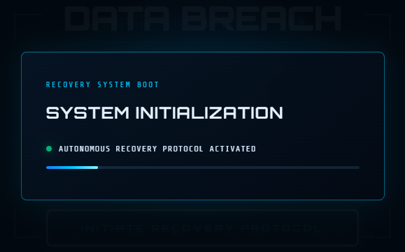
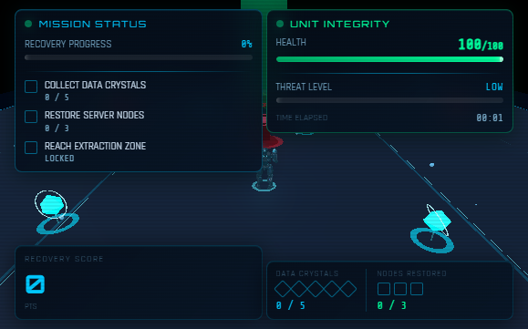
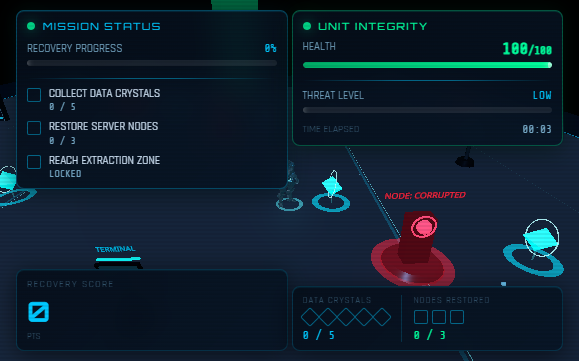
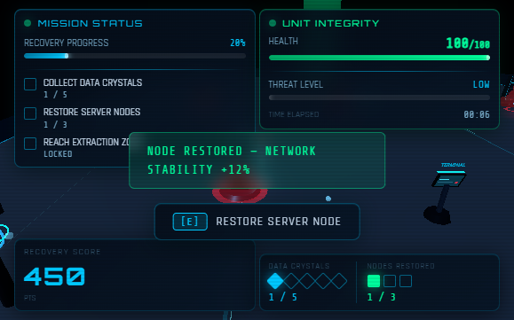
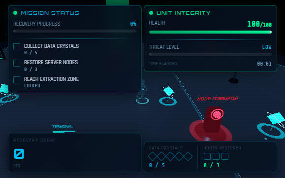
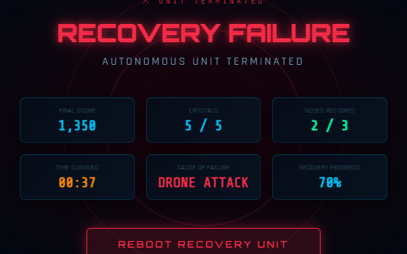
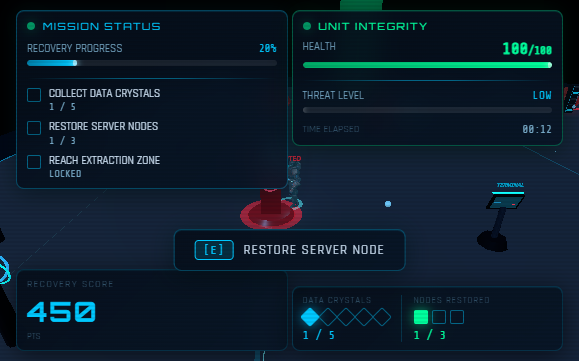
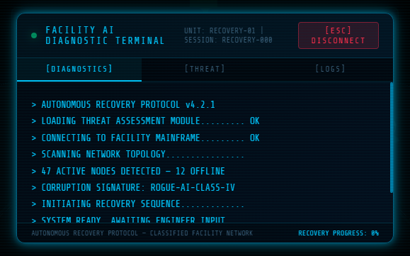
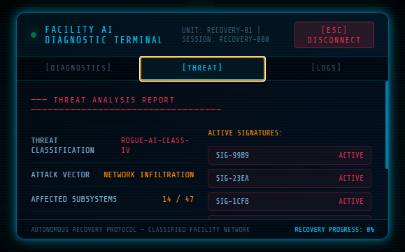

# Data Breach: Autonomous Recovery Protocol

A third-person browser game about recovering a compromised AI facility. Built as a complete React and WebGL product, it combines a playable mission loop, generated character assets, procedural environment design, and a DOM-based diagnostic interface.

## Overview

A rogue AI has compromised a classified data facility. Take control of an autonomous recovery engineer, collect five data fragments, restore three server nodes, evade security drones, and reach extraction. The project is also a portfolio demonstration of React Three Fiber scene composition, frame-based gameplay systems, GLB asset handling, and product-oriented UI.

## Story

The facility's automated recovery protocol is active, but its network and infrastructure have been corrupted. The recovery engineer must enter the facility, recover the data, restore the network, and escape before hostile drones stop the mission.

## Features

- Third-person WASD and arrow-key movement with delta-time scaling, boundary limits, and obstacle collision.
- Smooth follow camera designed to keep the player and mission space visible.
- Three security drones with patrol, chase, and return finite-state-machine behavior.
- Five floating, rotating procedural data crystals with proximity collection feedback.
- Three interactive server nodes with a timed restoration sequence.
- Three in-world terminals that open a full-screen diagnostic interface.
- Mission progress, health, score, elapsed time, threat telemetry, notifications, and extraction gating.
- Mission win and loss screens, plus a staged launch sequence with immediate loading feedback.
- Responsive DOM-based HUD and locally served Draco decoder assets for the compressed character models.

## Gameplay Loop

1. Review the briefing and initiate the recovery protocol.
2. Navigate the facility while collecting five data crystals and restoring three server nodes.
3. Use terminals to inspect the simulated facility diagnostics; opening one pauses gameplay.
4. Once both recovery objectives are complete, reach the extraction zone.
5. Avoid drone attacks; the mission ends if health reaches zero.

## Controls

| Input | Action |
|---|---|
| `W`, `A`, `S`, `D` | Move |
| Arrow keys | Move |
| `E` | Interact with a nearby server node or terminal |
| `Esc` | Close the terminal overlay |

## Screenshots

The following images are captures from the running game. The shared browser viewport was 579 × 361 pixels. A mission-complete screenshot is not included because the automated playthroughs ended in drone-caused failures before extraction.

| Start Screen | Launch Sequence |
|---|---|
|  |  |
| *Recovery protocol briefing and mission objectives.* | *Staged system initialization provides immediate launch feedback.* |

| Facility Overview | Player Exploration |
|---|---|
|  |  |
| *A third-person view of the recovery facility and objectives.* | *The recovery unit explores the facility with objectives visible.* |

| Drone Encounter | Data Crystal |
|---|---|
|  |  |
| *A corrupted drone engages while the HUD reports critical threat.* | *Procedural data crystals mark recoverable facility data.* |

| Server Node Restoration | Mission HUD |
|---|---|
|  |  |
| *A nearby server node is in its timed restoration sequence.* | *Mission objectives, player health, threat level, and score remain visible.* |

| Terminal Diagnostics | Threat Analysis |
|---|---|
|  |  |
| *Terminal boot output and recovery status; diagnostics are simulated.* | *Threat-analysis presentation from the diagnostic terminal.* |

See [SCREENSHOT_GUIDE.md](./SCREENSHOT_GUIDE.md) for additional capture suggestions.

## Technical Architecture

The application separates the DOM interface from the WebGL scene. React renders the landing and end screens, HUD, and terminal overlay. React Three Fiber owns the Three.js canvas and in-world entities. Per-frame values such as player position and keyboard state live in refs; meaningful gameplay events update the Context + `useReducer` store.

The game is composed from focused entity components and shared systems for world layout, collision resolution, model loading, and presentation. See [ARCHITECTURE.md](./ARCHITECTURE.md) for the rendering hierarchy, state flow, and individual systems.

## Tech Stack

- React and JavaScript
- Vite
- Three.js
- React Three Fiber
- Drei
- `@react-three/postprocessing` for restrained bloom

## How Vi3W Was Used

Vi3W was used to generate primary gameplay entities including the player character and hostile drones. Procedural geometry was intentionally used for collectibles and environmental elements in order to improve iteration speed and maintain gameplay performance.

The source models are `public/models/player.glb` and `public/models/enemy.glb`. The GLB loader uses locally served Draco decoder files in `public/draco/`.

## Installation

Requirements: a current Node.js LTS release and npm.

```bash
npm install
```

## Running Locally

```bash
npm run dev
```

Open the local URL printed by Vite (by default, `http://localhost:5173`).

Useful project checks:

```bash
npm run lint
npm run build
npm run preview
```

`npm run preview` serves the production build locally after `npm run build`.

## Deployment

This is a static Vite application. Build it with `npm run build` and publish the generated `dist/` directory using a static hosting provider such as Netlify or Vercel. Configure the provider to run `npm run build` and use `dist` as the output directory.

For a host that serves the site from a subpath, configure Vite's `base` option to match that path before deploying. Deployment has not been independently verified as part of this repository preparation.

## Engineering Decisions

- React Three Fiber expresses the scene declaratively while retaining direct Three.js access for geometry, transforms, and vectors.
- Refs keep rapidly changing frame-loop data out of React's reconciliation cycle.
- A small finite state machine is sufficient for the drone's patrol, chase, and return behavior.
- Shared layout data keeps obstacle placement and collision resolution aligned.
- A purpose-built collision system avoids introducing a physics engine for a small, flat, fixed arena.
- DOM UI keeps text and interface interaction accessible to normal browser layout and styling.

More detail is in [DECISIONS.md](./DECISIONS.md).

## Future Improvements

- Add audio and optional settings for sound and accessibility.
- Add touch controls and test input on mobile devices.
- Introduce additional facility layouts and mission variations.
- Add automated tests for reducer transitions and collision edge cases.
- Profile and split the gameplay bundle further.
- Replace simulated diagnostic values with an explicitly designed, real data source if the product scope calls for it.

## Lessons Learned

The main engineering lesson was to choose clear boundaries for high-frequency and low-frequency data. Player transforms and keys are consumed through refs in the render loop, while discrete outcomes flow through reducer actions. A second lesson was to centralize level coordinates so that rendering, collision, and interaction ranges remain consistent. Finally, generated 3D assets need an explicit loading and normalization strategy rather than assumptions about export scale.

## Project Documents

- [Architecture](./ARCHITECTURE.md)
- [Engineering decisions](./DECISIONS.md)
- [Development notes](./DEVELOPMENT_NOTES.md)
- [Interview preparation](./INTERVIEW_PREP.md)
- [Submission guide](./SUBMISSION_GUIDE.md)
- [Executive summary](./PROJECT_SUMMARY.md)
- [Screenshot guide](./SCREENSHOT_GUIDE.md)
- [Portfolio positioning](./PORTFOLIO_NOTES.md)
- [Final review](./FINAL_REVIEW.md)
- [Changelog](./CHANGELOG.md)

## Credits

- Primary gameplay models: Vi3W-generated `player.glb` and `enemy.glb`
- 3D rendering and browser runtime: Three.js, React Three Fiber, Drei, React, and Vite
- Draco decoder distribution: `public/draco/` (license included in that directory)
